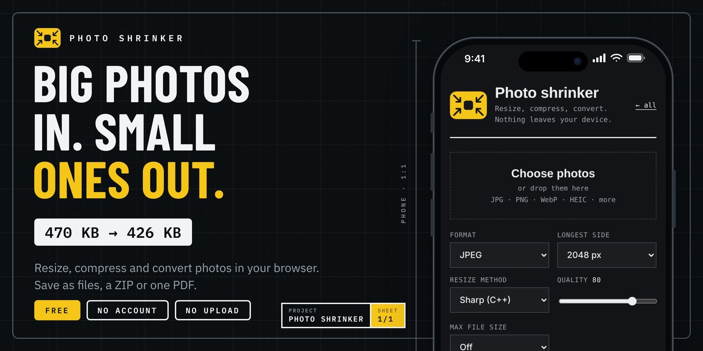

# Photo shrinker



Resize, compress and convert photos in your browser. Nothing is uploaded.

**[Open the app](https://davydmedvedchuk.github.io/photo-shrinker/)**

Pick photos, choose a size and a format, save. One photo or a ZIP. It runs entirely in the page, so your pictures never leave your device. No account, no ads, no install.

## What it does

- **Resize.** Longest side: original, 3000, 2048, 1600, 1200, 800, 400 px or any number you type.
- **Sharp resizing in C++.** The default resize method is a Lanczos-3 resampler written in C++ (`wasm/resize.cpp`), compiled to WebAssembly (4 KB). It keeps edges cleaner than the browser's own scaler and handles transparency correctly. If it can't load, or the photo is over 36 megapixels, the app switches to the browser scaler by itself. Pick "Fast (browser)" to turn it off.
- **Compress.** A quality slider for JPEG and WebP.
- **Max file size.** Say "under 200 KB" and it finds the best quality that fits. If quality alone is not enough, it shrinks the picture a little.
- **Convert.** Save as JPEG, PNG, WebP, BMP or ICO.
- **Many photos at once.** Download one by one, as a ZIP, or as a single PDF (one photo per A4 page).
- **HEIC.** iPhone photos open on any browser. The decoder loads only when you add a HEIC file.
- **Privacy.** Saving a photo again removes EXIF data, including GPS location.
- **Already small?** If a photo can't get smaller, you get the original back, not a bigger file.

## Formats

| In | Out |
| --- | --- |
| JPEG, PNG, WebP, GIF (first frame), BMP, HEIC. What else works depends on your browser. | JPEG, PNG, WebP\*, BMP, ICO, PDF, ZIP |

\*Safari can't encode WebP, so the option is hidden there.

## Run it yourself

It is a static page. Open `index.html`, or serve the folder:

```
python3 -m http.server
```

Then go to `http://localhost:8000`.

## Command-line version (Python)

The same job for a whole folder, no browser. It lives in `cli/` and uses Pillow and pillow-heif.

```
pip install -r cli/requirements.txt
python3 cli/shrink.py ./photos                      # 2048 px JPEGs into ./shrunk
python3 cli/shrink.py ./photos -s 1200 -m 200       # longest side 1200 px, each file under 200 KB
python3 cli/shrink.py ./photos -r -f webp --zip     # subfolders too, WebP, one ZIP
```

Options: `-s` size, `-f` format (jpg, png, webp, bmp, ico), `-q` quality, `-m` max KB, `-r` recursive, `--zip`, `--pdf`, `-o` output folder. HEIC works. Like the web app, it keeps the original if it can't make the file smaller.

**No Python?** A Windows `shrink.exe` is built by GitHub Actions (`.github/workflows/build-exe.yml`). Run it from the Actions tab, or push a tag like `v1.0` and the exe appears under Releases. Then: `shrink.exe C:\\photos -s 1200`.

## Rebuilding the C++ part

The compiled `wasm/resize.wasm` is in the repo, so you don't need to build anything. To change `resize.cpp`, you need clang with the wasm32 target and `wasm-ld`:

```
./wasm/build.sh
```

No Emscripten and no libc: the module has its own allocator and math.

## How it works

Each photo is decoded by the browser, drawn on a canvas at the new size and encoded again. "Max file size" is a binary search over the quality value. The ZIP and PDF writers are small and live in `index.html`, so there is nothing to build.

## Not included

No AVIF, GIF or TIFF output. No option to keep EXIF. Very large photos can be slow on old phones.

## Credits

Made by Davyd Medvedchuk. HEIC decoding uses [heic2any](https://github.com/alexcorvi/heic2any) (MIT, see `vendor/LICENSE-heic2any.md`).

MIT licence.
